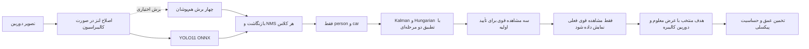

# مرور منابع و تصمیم‌های ارتقای ۳٫۱

این بررسی روی ۱۳ منبع اصلی منتخب دربارهٔ تشخیص، ردیابی، اهداف کوچک و فاصله متمرکز است. فایل کامل PDF منابع دریافت و متن استخراج شد؛ بخش‌های فنیِ مرتبطِ مشخص‌شده در جدول بررسی شدند، نه تمام صفحات همهٔ منابع و نه تمام ادبیات این حوزه. تاریخ دسترسی ۲۰۲۶-۱۱-۰۳ است. «بهترین» در اینجا انتخاب سازگار با CPU گوشی و شواهد موجود است؛ هیچ رتبه‌بندی جامعِ تمام مدل‌ها روی گوشی کاربر انجام نشده است.

| منبع اصلی | بخش بررسی‌شده | نتیجه و تصمیم برای این پروژه |
|---|---|---|
| [SORT — Bewley et al.](https://arxiv.org/abs/1602.00763) | ۳٫۲ تا ۳٫۴: پیش‌بینی، تطبیق، عمر مسیر | تطبیق حریصانهٔ نسخهٔ ۳ با تخصیص دقیق Hungarian جایگزین شد. فیلتر Kalman فقط در تطبیق کمک می‌کند؛ کادر پیش‌بینی‌شده به خروجی شناسایی نمی‌رود. |
| [ByteTrack — Zhang et al.](https://arxiv.org/abs/2110.06864) | بخش ۳، الگوریتم ۱ و رفتار lost track | دو مرحلهٔ تطبیق امتیاز بالا/پایین اضافه شد. تشخیص ضعیف فقط مسیر قبلاً تأییدشده را موقتاً نگه می‌دارد؛ مسیر تازه نمی‌سازد و به کاربر نمایش داده نمی‌شود. |
| [BoT-SORT — Aharon et al.](https://arxiv.org/abs/2206.14651) | ۳٫۱، ۳٫۲ و محدودیت‌های ۴٫۴ | حالت هشت‌بعدی مرکز/عرض/ارتفاع و سرعت آنها انتخاب شد. از نسبت ابعاد ثابت برای انسان/خودرو استفاده نمی‌شود. ReID و جبران حرکت دوربین پیاده نشده‌اند؛ هزینه و شکست احتمالی آنها در پس‌زمینه‌های کم‌بافت باید روی ویدئوی واقعی سنجیده شود. |
| [OC-SORT — Cao et al.](https://arxiv.org/abs/2203.14360) | بخش‌های ۳ و ۴: انباشت خطا و ORU/OCM | محدودیت پیش‌بینی بلندمدت لحاظ شد: مسیر فقط دو فریم فقدان را به‌صورت پنهان نگه می‌دارد و زمان عمر محدود دارد. اندازهٔ فاصله فقط از مشاهدهٔ فعلی می‌آید. ORU و OCM کامل پیاده‌سازی نشده‌اند. |
| [SAHI — Akyon et al.](https://arxiv.org/abs/2202.06934) | روش برش، ادغام و نتایج اهداف کوچک | حالت اختیاری تصویر کامل به‌علاوهٔ چهار برش هم‌پوشان اضافه شد؛ بازنگاشت مختصات و NMS جدا برای دو کلاس انجام می‌شود. برش داخلی که جسم را قطع کند رد می‌شود تا عرض ناقص وارد فاصله نشود. آموزش برشی مقاله انجام نشده است. |
| [Zhang — A Flexible New Technique for Camera Calibration](https://www.microsoft.com/en-us/research/wp-content/uploads/2016/02/tr98-71.pdf) | ۳٫۲ تا ۳٫۴ و بخش ۴: خطای تصویر، اعوجاج و وضعیت‌های تباهیده | کالیبراسیون لنز اکنون خطای هر عکس، پالایش مقاوم عکس‌های پرت، تنوع جهت صفحه، پوشش تصویر و عدم‌قطعیت درونیِ مشروط را کنترل می‌کند. ابزار کالیبراسیون فاصله نیز باقیمانده را در فضای پیکسل برازش می‌کند. این کنترل‌های افزوده بازتولید دقیق آزمایش‌های مقاله نیستند. |
| [Depth Anything V2 — Yang et al.](https://arxiv.org/abs/2406.09414) | بخش ۷٫۳ و محدودیت‌های ضمیمه D | نسخهٔ عمق نسبی را نباید مستقیماً متر نامید. مدل‌های متری نیاز به آموزش/مدل مناسب دارند. به مسیر پیش‌فرض گوشی اضافه نشد؛ افزایش دقت متری برای این دوربین از مقاله نتیجه نمی‌شود. |
| [Depth Pro — Bochkovskii et al.](https://arxiv.org/abs/2410.02073) | چکیده و روش شبکه/برآورد فاصلهٔ کانونی | معماری چندمقیاسی و خروجی متری ارزش بررسی روی سخت‌افزار قوی دارند؛ زمان زیر یک ثانیهٔ مقاله روی GPU است. روی CPU گوشی آزموده نشده و وزن سنگین آن به بسته اضافه نشده است. |
| [UniDepth — Piccinelli et al.](https://arxiv.org/abs/2403.18913) | ۳٫۱ و ۳٫۲: نمایش سه‌بعدی و camera prompting | تخمین هم‌زمان دوربین و عمق مبتنی بر prior آموخته‌شده است؛ جایگزین اندازه‌گیری قطعی دوربین کاربر نیست. برای این نسخهٔ CPU به‌صورت پیش‌فرض انتخاب نشد و پیاده‌سازی/اعتبارسنجی نشده است. |
| [RT-DETR — Zhao et al.](https://arxiv.org/abs/2304.08069) | benchmark سرعت انتهابه‌انتها و encoder ترکیبی | سرعت و مزیت NMS-free به سخت‌افزار و خروجی مدل وابسته‌اند. تعویض decoder مدل YOLO11 با خروجی DETR بدون مدل و ارزیابی مجزا صحیح نیست. وزن/معماری پروژه از این مقاله جایگزین نشد. |
| [YOLOv10 — Wang et al.](https://arxiv.org/abs/2405.14458) | ۳٫۱، dual assignments و جدول مقایسه | حذف NMS حاصل طراحی و آموزش مدل است؛ با حذف یک تابع از مدل فعلی به دست نمی‌آید. دیکودر فعلی برای وزن‌های بررسی‌شده حفظ شد. |
| [Focal Loss — Lin et al.](https://arxiv.org/abs/1708.02002) | ۳٫۲ و تمایز نمونهٔ منفی آسان/سخت | راه‌حل عدم‌توازن داده در مرحلهٔ آموزش است، نه فیلتر جادویی زمان اجرا. ضرورت دیوار، سایه، بازتاب، پوستر و پس‌زمینه‌های واقعیِ منفی در داده مستند شد. loss مدل حاضر تغییر نکرد و آموزش مجددی انجام نشد. |
| [GIoU — Rezatofighi et al.](https://arxiv.org/abs/1902.09630) | بخش ۳ و تعریف metric/loss | بهبود loss کادر نیازمند آموزش است. ادعای اضافه‌کردن GIoU به وزن ثابت نداریم؛ IoU برای تطبیق و ارزیابی قابل‌آزمون حفظ شد. |

## مسیر واقعی اجرا

این tracker ترکیبیِ محافظه‌کارانه از ایده‌هاست؛ نام ByteTrack، BoT-SORT یا OC-SORT کامل به آن داده نشده است. آستانه‌ها، نویز Kalman و عمر مسیر، پیش‌فرض مهندسی هستند و روی دادهٔ دوربین کاربر بهینه نشده‌اند. در عبور دو انسان مشابه از هم، پوشیدگی طولانی، حرکت شدید دوربین یا شناسایی کاذب پایدار، هنوز جابه‌جایی شناسه یا خطا ممکن است.

## تغییر ریاضی کالیبراسیون فاصله

در نسخهٔ ۳، برای هر مشاهده `fᵢ = wᵢ Zᵢ / Wᵢ` محاسبه و میانه گرفته می‌شد. با نویز پیکسلی مشابه، یک کادر دورِ ۲۰پیکسلی اطلاعات کمتری از کادر نزدیکِ ۲۰۰پیکسلی دربارهٔ فاصلهٔ کانونی دارد. در ۳٫۱:

۱. میانه و MAD همچنان نمونه‌های ناسازگار را غربال می‌کنند.
۲. با ثابت‌بودن اندازه و فاصلهٔ مرجع، مدل `wᵢ = f (Wᵢ/Zᵢ)` در فضای پیکسل با Huber و IRLS برازش می‌شود؛ رزولوشن‌ها قبل از برازش یکسان‌سازی می‌شوند.
۳. اگر انحراف معیار واقعی اندازه‌گیری پیکسل معلوم باشد، `observed_width_std_px` قابل‌ارائه است؛ پیش‌فرض ۲ پیکسل صرفاً یک فرض آشکار است.
۴. عدم‌قطعیت شرطی گزارش‌شده فقط نویز پیکسلی فرض‌شده را پوشش می‌دهد؛ خطای متر، عرض مرجع، ژست، زوم و bias مدل را پوشش نمی‌دهد.

Huber/IRLS و MAD اجزای آماری استاندارد پیاده‌سازی‌اند؛ به‌عنوان الگوریتم ابداعی مقالهٔ Zhang یا بهبود تضمین‌شده در تمام توزیع‌های خطا معرفی نمی‌شوند. تلاش دسترسی به PDF اصلی Huber 1964 به صفحهٔ HTML غیرقابل‌خواندن رسید؛ آن مقاله جزو ۱۳ منبع مطالعه‌شده شمرده نشده است.

## آنچه هنوز لازم است

برای پایین‌آوردن خطای واقعی دیوار، ویدئوهای نمایندهٔ همان محل و برچسب صحیح لازم است. الگوریتم ارزیابی اکنون خطای تصاویر منفی، precision/recall جداگانهٔ انسان و خودرو و انتخاب آستانه با هدف precision و حداقل recall را گزارش می‌کند. بازهٔ Wilson با فرض استقلال تشخیص‌ها گزارش می‌شود؛ فریم‌های هم‌بسته می‌توانند این بازه را خوش‌بینانه کنند.

وزن‌های YOLO11n/s همان وزن‌های پیش‌آموزش‌دیدهٔ بستهٔ قبلی‌اند؛ تغییر این نسخه در استنتاج، تطبیق، کالیبراسیون و ارزیابی است. هیچ مدل روی Kaggle یا ویدئوهای کاربر دوباره آموزش ندیده است. منابع و SHA-256 PDFهای دریافت‌شده در `validation/paper_manifest.json` ثبت شده‌اند؛ PDFهای دیگران داخل ZIP بازتوزیع نشده‌اند.
